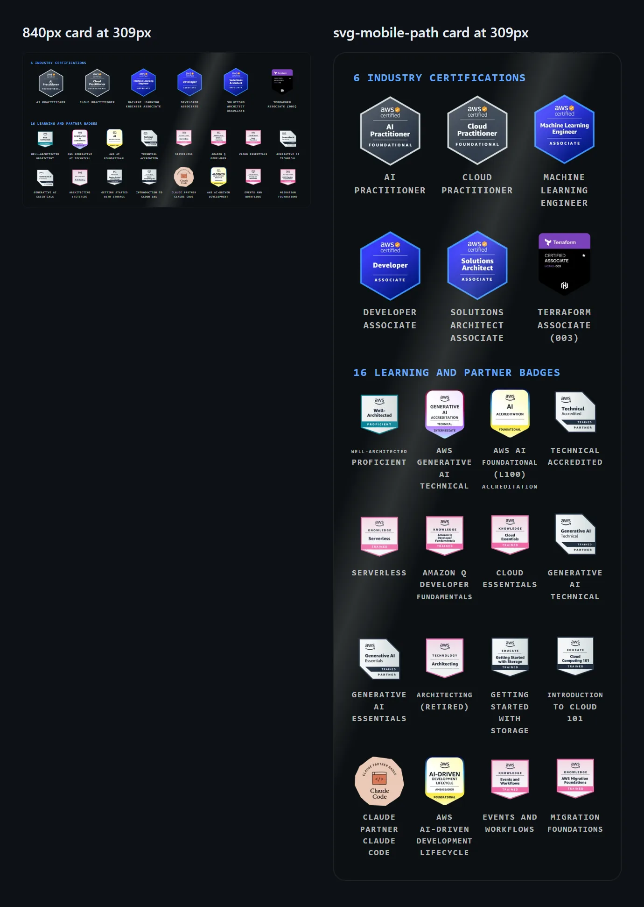
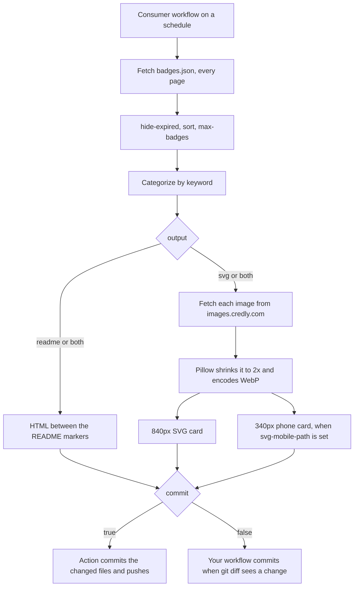

# Credly Badge README Updater

[](https://github.com/marketplace/actions/credly-badge-readme-updater)
[](https://github.com/Sagargupta16/credly-badge-readme-action/actions/workflows/ci.yml)
[](https://github.com/Sagargupta16/credly-badge-readme-action)
[](https://github.com/Sagargupta16/credly-badge-readme-action)
[](LICENSE)
[](https://github.com/Sagargupta16/credly-badge-readme-action/commits/main)

**Auto-sync your Credly certifications and badges to your GitHub profile README.**

No more manually updating badge images when you earn a new certification. This Action fetches your badges from Credly's public API and updates your README automatically.

<a href="#svg-card-mode"><picture><source media="(max-width: 600px)" srcset="examples/credly-badges-mobile.svg"></picture></a>

That card is this action's `output: svg`, drawn from a live profile of 22 badges. Open
this page on a phone and you get the narrower `svg-mobile-path` card instead.

---

## Features

- Fetches all badges from your Credly profile automatically
- Categorizes badges into **Industry Certifications**, **Professional/Partner**, and **Knowledge/Learning**
- Updates your README between markers (non-destructive -- only touches the badge section)
- Optional [SVG card mode](#svg-card-mode): every badge in one self-hosted, animated SVG,
  plus an optional [phone card](#phone-card) that stays readable on a 375px screen
- [Choose the badges](#choose-which-badges-show): hide expired ones, sort newest or oldest
  first, cap the count
- Optional [commit and push](#let-the-action-commit) from inside the action, so the
  workflow is one step
- Configurable badge size, retry logic, and categorization keywords
- Outputs badge counts for use in downstream workflow steps

## Quick Start

### 1. Add markers to your README

Add these two HTML comments where you want your badges to appear:

```markdown
## Certifications

<!-- CREDLY-BADGES:START -->
<!-- CREDLY-BADGES:END -->
```

### 2. Create the workflow

Create `.github/workflows/update-credly-badges.yml`:

```yaml
name: Update Credly Badges

on:
  schedule:
    - cron: "0 9 * * 1" # Every Monday at 9 AM UTC
  workflow_dispatch:

permissions:
  contents: write

jobs:
  update-badges:
    runs-on: ubuntu-latest
    steps:
      - uses: actions/checkout@v7

      - name: Update Credly badges
        uses: Sagargupta16/credly-badge-readme-action@v1
        with:
          credly-username: "your-credly-username"

      - name: Commit changes
        run: |
          git config user.name "github-actions[bot]"
          git config user.email "41898282+github-actions[bot]@users.noreply.github.com"
          git add README.md
          if ! git diff --cached --quiet; then
            git commit -m "chore: update Credly badges"
            git push
          fi
```

### 3. Find your Credly username

Go to your [Credly profile](https://www.credly.com/users/me) and copy the username from the URL:
```
https://www.credly.com/users/YOUR-USERNAME-HERE
```

That's it. Your badges will auto-update every Monday.

## Inputs

| Input | Required | Default | Description |
|-------|----------|---------|-------------|
| `credly-username` | Yes | - | Your Credly username from your profile URL |
| `readme-path` | No | `README.md` | Path to your README file |
| `badge-size` | No | `100` | Badge image size in pixels (README mode) |
| `max-retries` | No | `3` | Max retry attempts for Credly API calls |
| `cert-keywords` | No | `Certified` | Comma-separated keywords to identify industry certifications |
| `professional-keywords` | No | `Partner: Technical,...` | Comma-separated keywords for professional/partner badges |
| `output` | No | `readme` | `readme` updates the marker section, `svg` writes the [SVG card](#svg-card-mode), `both` does both |
| `svg-path` | No | `assets/credly-badges.svg` | Where the SVG card is written; missing folders are created |
| `svg-groups` | No | `two` | SVG grouping: `two` (certifications, then every other badge) or `three` (the README's categories) |
| `svg-per-row` | No | `6,8` | Badges per row for each SVG group, 1 to 12; the last value repeats for later groups |
| `svg-mobile-path` | No | empty | Also write the 340px [phone card](#phone-card) here (`svg` or `both`); empty draws none |
| `accent` | No | `#60a5fa` | Hex color of the SVG group labels; quote it, an unquoted `#` starts a YAML comment |
| `hide-expired` | No | `false` | `true` leaves out badges whose Credly expiry date has passed |
| `sort` | No | `credly` | `credly` keeps your profile order; `newest` or `oldest` sorts by issue date |
| `max-badges` | No | `0` | Show at most this many badges, counted after `hide-expired` and `sort`; `0` shows all |
| `commit` | No | `false` | `true` commits and pushes the written files when they changed, as `github-actions[bot]` |
| `commit-message` | No | `chore: update Credly badges` | Message for the commit `commit: true` makes |

`svg-mobile-path`, `hide-expired`, `sort`, `max-badges`, `commit` and `commit-message`
are new in `v1.3.0`.

## Outputs

| Output | Description |
|--------|-------------|
| `total-badges` | Number of badges written, after `hide-expired` and `max-badges` |
| `certifications-count` | Number of industry certifications |
| `professional-count` | Number of professional/partner badges |
| `knowledge-count` | Number of knowledge/learning badges |
| `changed` | Whether the README or an SVG card was updated (`true`/`false`) |

> **Note:** `v1.0.0` only: these five outputs resolve to an empty string there. Fixed in
> `v1.1.0`; `@v1` and every later tag set them. See [Pinning and security](#pinning-and-security).

## Example Output

The action generates up to three categorized sections, rendering at the default
`badge-size` of 100 pixels:

**Industry Certifications**

<div align="center">
<a href="https://www.credly.com/badges/591e74ef-f6a8-4b77-82dc-07e06fb8060e" title="AWS Solutions Architect"></a>
<a href="https://www.credly.com/badges/be7f9e0a-593a-4544-8dfd-f69f669ec57d" title="AWS Developer"></a>
<a href="https://www.credly.com/badges/8b0723a5-bac7-4262-b5b6-20337b2979a1" title="Terraform Associate"></a>
</div>

**Professional & Partner Badges**

<div align="center">
<a href="https://www.credly.com/badges/ea4a5540-aa93-4f8b-96d2-9bf31de86f72" title="Well-Architected"></a>
<a href="https://www.credly.com/badges/4850c937-dcee-4f8f-9e1c-50263e4e7f92" title="GenAI Technical"></a>
</div>

**Knowledge & Learning Badges**

<div align="center">
<a href="https://www.credly.com/badges/d03e1d39-4e40-483d-9845-f11da0d01170" title="Cloud Essentials"></a>
<a href="https://www.credly.com/badges/ca2a1336-e6e0-4e76-aa97-a919759d26d3" title="Architecting"></a>
</div>

Each badge is an anchor to its Credly verification page, exactly as shown above. Two
simplifications in this preview: the real output uses the full badge name from the API
for `alt` and `title`, and it prefixes every heading with an emoji (a sports medal, a
military medal, books).

A category with no matching badges is skipped entirely, heading included.

## SVG card mode

Set `output: svg` and the action draws every badge into one self-hosted, animated SVG
card instead of editing a README section; `output: both` does both. Available from
`v1.1.0`. The card at the [top of this page](#credly-badge-readme-updater) is one.

The card is a single file that loads nothing else. GitHub serves README images through
an ``, which cannot fetch external resources, so the action downloads each badge
image from `images.credly.com` when it runs and inlines it as a data URI. The fade-in,
float and shine are CSS and SMIL only. With the pinned Pillow, the same badges render
the same bytes on every run, so `git diff` is an exact change check.

- **Grouping** reuses `cert-keywords` and `professional-keywords`. `svg-groups: two`
  (the default) draws industry certifications, then every other badge as "Learning and
  partner badges"; `three` keeps the README's three categories.
- **Layout**: `svg-per-row` sets the badges per row for each group, comma-separated
  (default `6,8`), and the last value repeats for later groups. If a row gets more
  badges than the design has room for, badges and labels shrink to fit their column.
- **Labels**: en and em dashes in badge titles become plain hyphens, and the label
  under each badge drops common issuer prefixes such as `AWS Certified` and
  `HashiCorp Certified:`. The full titles stay in the card's `aria-label`.
- **Color**: `accent` sets the group label color. Quote it (`accent: "#f59e0b"`),
  since an unquoted `#` starts a YAML comment.
- **Size**: when `output` is not `readme`, the action installs one pinned wheel,
  `pillow==13.0.0`, shrinks each image to twice its drawn size, sharp on high-density
  screens, and inlines it as WebP (quality 85, transparency kept exactly). The example
  above holds 22 badges in about 125 KB, against 391 KB with the PNG images that
  `v1.1.x` inlined. Every current browser draws WebP inside an SVG shown through
  ``, which is how GitHub shows it. README mode installs nothing.

A workflow that renders the card weekly and commits it only when git sees a change:

```yaml
name: Update Credly badge card

on:
  schedule:
    - cron: "0 9 * * 1" # Every Monday at 9 AM UTC
  workflow_dispatch:

permissions:
  contents: write

jobs:
  update-card:
    runs-on: ubuntu-latest
    steps:
      - uses: actions/checkout@v7

      - name: Render the Credly badge card
        uses: Sagargupta16/credly-badge-readme-action@v1
        with:
          credly-username: "your-credly-username"
          output: svg

      - name: Commit the card if it changed
        run: |
          git config user.name "github-actions[bot]"
          git config user.email "41898282+github-actions[bot]@users.noreply.github.com"
          git add assets/credly-badges.svg
          if ! git diff --cached --quiet; then
            git commit -m "chore: update Credly badge card"
            git push
          fi
```

Then show the card in your README, linked to your Credly profile:

```markdown
[](https://www.credly.com/users/your-credly-username)
```

### Phone card

GitHub draws a README 309px wide on a 375px phone, so the 840px card shrinks to 37% and
its badge labels to 3.9px. Set `svg-mobile-path` and the action also writes a 340px
card: three certifications and four other badges a row, labels of up to three and four lines,
drawn at 91% on that phone with 10px labels. Both cards use the same images at the same
sizes, so the second card downloads nothing extra; the example phone card is 126,085
bytes. Available from `v1.3.0`.



Those numbers come from [`scripts/phone-preview.py`](scripts/phone-preview.py), which
opens this repo on github.com at a 375px viewport, measures the README width, and draws
both example cards at it (run 2026-10-18).

Add the path to the step above and to its `git add`:

```yaml
        with:
          credly-username: "your-credly-username"
          output: svg
          svg-mobile-path: assets/credly-badges-mobile.svg
```

Then let the browser pick the card by screen width. GitHub keeps `<picture>` and its
`media` query, so a phone loads only the phone card:

```html
<a href="https://www.credly.com/users/your-credly-username"><picture>
  <source media="(max-width: 600px)" srcset="assets/credly-badges-mobile.svg">
  
</picture></a>
```

## Advanced Usage

### Custom categorization

Override how badges are categorized using keywords matched against the badge name:

```yaml
- uses: Sagargupta16/credly-badge-readme-action@v1
  with:
    credly-username: "your-username"
    cert-keywords: "Certified,Professional"
    professional-keywords: "Partner,Proficient,Associate"
```

Matching is a **case-sensitive substring test** against each badge's
`badge_template.name` from the Credly API. Certification keywords are tested first, so
a badge matching both lists lands in Industry Certifications.

The defaults (`Certified` plus four AWS partner strings) are AWS-shaped, and anything
matching neither list lands in Knowledge & Learning. Pick keywords from your own badge
names rather than guessing, since issuers word and rename them differently:

```bash
curl -s "https://www.credly.com/users/YOUR-USERNAME/badges.json" \
  | python -c "import json,sys; [print(b['badge_template']['name']) for b in json.load(sys.stdin)['data']]"
```

### Choose which badges show

```yaml
- uses: Sagargupta16/credly-badge-readme-action@v1
  with:
    credly-username: "your-username"
    hide-expired: true # drop certifications past their Credly expiry date
    sort: newest # newest first by issue date; oldest also works
    max-badges: 12 # then keep the first 12
```

All three apply to README mode and the SVG cards alike, before categorization, so
`max-badges: 12` means 12 badges in total, not 12 a category. A badge counts as expired
from the day after its `expires_at_date`; a badge without one never expires. With
`sort: newest` or `oldest`, badges issued the same day keep their profile order and
badges without an issue date go last. The defaults keep every badge in your Credly
profile order, which is what every earlier version did. Available from `v1.3.0`.

### Let the action commit

`commit: true` replaces the commit step. The action commits only the files it wrote
(the README, the card, the phone card) as `github-actions[bot]`, only when one of them
changed, and pushes to the branch the checkout is on. The job still needs
`permissions: contents: write`. Available from `v1.3.0`.

```yaml
permissions:
  contents: write

jobs:
  update-badges:
    runs-on: ubuntu-latest
    steps:
      - uses: actions/checkout@v7

      - uses: Sagargupta16/credly-badge-readme-action@v1
        with:
          credly-username: "your-credly-username"
          commit: true
          commit-message: "chore: update Credly badges" # the default
```

### Conditional commit (only when changed)

```yaml
- name: Update Credly badges
  id: credly
  uses: Sagargupta16/credly-badge-readme-action@v1
  with:
    credly-username: "your-username"

- name: Commit if changed
  if: steps.credly.outputs.changed == 'true'
  run: |
    git config user.name "github-actions[bot]"
    git config user.email "41898282+github-actions[bot]@users.noreply.github.com"
    git add README.md
    git commit -m "chore: update ${{ steps.credly.outputs.total-badges }} Credly badges"
    git push
```

### Use badge counts in other steps

```yaml
- name: Update Credly badges
  id: credly
  uses: Sagargupta16/credly-badge-readme-action@v1
  with:
    credly-username: "your-username"

- name: Summary
  run: |
    echo "Found ${{ steps.credly.outputs.total-badges }} badges:"
    echo "  Certifications: ${{ steps.credly.outputs.certifications-count }}"
    echo "  Professional:   ${{ steps.credly.outputs.professional-count }}"
    echo "  Knowledge:      ${{ steps.credly.outputs.knowledge-count }}"
```

## Live Example

[@Sagargupta16's profile README](https://github.com/Sagargupta16/Sagargupta16) runs this
action every Monday, pinned to `v1.2.0` by commit SHA, with `output: both`. Its
certifications card, `assets/svg/certs.svg`, is this action's SVG output: 22 Credly
badges, including 5 active AWS certifications. The workflow commits only when `git diff`
sees a change to the card or the badge section. On phones the profile swaps in a
narrower grid that its own renderer builds from the images inside this card.

**Used by** (public `@v1` workflows found by GitHub code search on 2026-10-18, all in
README mode): [Unknown27s](https://github.com/Unknown27s/Unknown27s),
[khaizr0](https://github.com/khaizr0/khaizr0) and [wogho](https://github.com/wogho/wogho).

## How It Works

<picture>
  <source media="(prefers-color-scheme: dark)" srcset="docs/diagrams/how-it-works-dark.svg">
  <source media="(prefers-color-scheme: light)" srcset="docs/diagrams/how-it-works-light.svg">
  
</picture>

The spec behind the picture is [`docs/diagrams/how-it-works.yaml`](docs/diagrams/how-it-works.yaml), rendered with [orrery](https://github.com/Sagargupta16/orrery).



1. Fetches badges from `https://www.credly.com/users/{username}/badges.json`, following
   `metadata.next_page_url` until the last page (Credly serves 48 badges a page)
2. Applies `hide-expired`, `sort` and `max-badges`; the defaults keep every badge in profile order
3. Categorizes each badge based on its name (using configurable keywords)
4. Generates HTML with linked badge images from Credly's CDN
5. Replaces content between `<!-- CREDLY-BADGES:START -->` and `<!-- CREDLY-BADGES:END -->` markers in your README
6. With `output: svg` or `both`, downloads each badge image, inlines it as a data URI and writes one SVG card to `svg-path`, plus the phone card to `svg-mobile-path` when it is set (with `svg`, steps 4 and 5 are skipped)
7. With `commit: true`, commits the written files and pushes when one of them changed
8. Reports badge counts via action outputs

## How it compares

Two other projects put Credly badges on a GitHub profile. Features as their own READMEs
describe them on 2026-10-18:

| | This action | [pemtajo/badge-readme](https://github.com/pemtajo/badge-readme) | [credly-readme-stats](https://github.com/ebenezer-isaac/credly-readme-stats) |
|---|---|---|---|
| Runs as | GitHub Action | GitHub Action | Hosted service on Render, or self-hosted |
| Reads Credly through | the public `badges.json` API | the profile page, in headless Chrome | not stated |
| Writes | README section, SVG card, phone card | README section | SVG served from its URL |
| Image lives in | your repo | Credly's CDN | the service |
| Grouping | certifications, partner, learning | none | none |
| Sort and filter | `sort`, `max-badges`, `hide-expired` | newest first, `NUMBER_LAST_BADGES` | `sort`, `max_items`, issuer and skill filters |
| On a phone | README section wraps; the card has a 340px phone version | README section wraps | one width per URL (`card_width`) |
| Themes | dark, with `accent` | plain images | 20 themes, light and dark |
| Commits for you | with `commit: true` | yes | nothing to commit |

Pick credly-readme-stats for themes and stats cards if a hosted image URL suits you.
Pick this action for a card that is a file in your own repo, loads nothing external and
has a phone layout.

## Design Decisions

- **README mode is standard library only.** The default path installs nothing, so a
  consumer has no package tree to audit. Pillow is the one dependency, pinned, and only
  installed when `output` is not `readme`.
- **Same badges, same bytes.** With the pinned Pillow the card is byte-identical on every
  run, and across the Windows and Linux `pillow==13.0.0` wheels (124,099 bytes both for
  the 1.3 card, checked 2026-10-18). That is what lets a consumer use `git diff` as the change check
  instead of trusting an output.
- **Self-contained SVG.** GitHub shows README images through an ``, which loads
  nothing external, so every badge is inlined as a data URI. Shrinking each image to
  twice its drawn size and encoding it as WebP takes the 22-badge example from 1,256,889
  bytes to 124,099 (the 1.3 card; 1.4's larger labels add about 1.2 KB).
- **Credly data is untrusted.** Every badge name and URL goes through `html.escape()`.
  Images are fetched only from `https://images.credly.com/` (urllib would also open a
  `file://` URL), and page links only under `https://www.credly.com/users/`.
- **Fail fast, retry only what can recover.** SVG inputs are validated before any network
  call. A `404` stops at once with the username hint; timeouts, `429` and `5xx` responses
  are retried, with a 5 s and then a 10 s wait at the default `max-retries` of 3.
- **Two cards, not one responsive card.** GitHub serves README images through an
  ``, and an SVG in an `` is laid out at its own `viewBox`, so it can only
  shrink, never reflow. A `<picture>` with a `media` query picks between two fixed
  layouts instead, and a phone loads only one of them.
- **CI runs `action.yml` itself.** `v1.0.0` shipped with all five outputs empty because a
  composite action needs an explicit `value:` mapping, and unit tests never load
  `action.yml`. The `action` job now runs the action from the checkout against a live
  profile and fails on any empty output.

## Troubleshooting

### "Could not find CREDLY-BADGES markers in README"

The script exits with status 1 when the marker pair is missing. Both comments must be
present, spelled exactly like this, in the file named by `readme-path`:

```markdown
<!-- CREDLY-BADGES:START -->
<!-- CREDLY-BADGES:END -->
```

If your badges live somewhere other than `README.md`, set `readme-path` to match.

### The action succeeds but nothing is committed

Unless you set `commit: true`, this action only edits the file on the runner and your
workflow commits it. Check, in order:

1. The job has `permissions: contents: write`.
2. Your workflow actually has a commit-and-push step (see [Quick Start](#2-create-the-workflow)).
3. If that step is gated on `if: steps.<id>.outputs.changed == 'true'` and shows as
   skipped while the log above it reads "README updated with latest Credly badges.",
   the output is empty: see [Pinning and security](#pinning-and-security).

### Every badge lands under "Knowledge & Learning"

Your badge names did not match `cert-keywords` or `professional-keywords`. Matching is a
case-sensitive substring test, and the defaults are AWS-shaped. List your real badge
names and pick keywords from them -- see
[Custom categorization](#custom-categorization).

### The badge section comes out empty

The script reads the public `badges.json` endpoint, so the Credly profile must be public
and must have at least one accepted badge. Confirm the endpoint returns data:

```bash
curl -s "https://www.credly.com/users/YOUR-USERNAME/badges.json" | head -c 200
```

A `404` means the username is wrong (it is the slug from your profile URL, which is not
always your display name). The action stops on it at once with
`Credly user '<name>' not found (404)` instead of retrying. An empty `data` array means
the profile is private or has no accepted badges.

## Pinning and Security

Pin to a full commit SHA and record the human-readable version in a trailing comment:

```yaml
- uses: Sagargupta16/credly-badge-readme-action@4026ed5438d30856fa7e65b8aa0bd6702777ed48 # v1.4.0
```

`@v1` is a moving major tag: it follows the latest 1.x release, so it changes under you;
a SHA does not. Each release's commit SHA is on the
[releases page](https://github.com/Sagargupta16/credly-badge-readme-action/releases).

Security:

- **No secrets.** The action takes no token and needs none. It reads one public,
  unauthenticated endpoint: `https://www.credly.com/users/{username}/badges.json`. In
  SVG mode it also downloads the badge images, only from `https://images.credly.com/`;
  an image URL on any other host is refused.
- **No third-party dependencies in README mode.** The script is Python standard library
  only, so there is no transitive package tree to audit. SVG mode adds exactly one
  package, `pillow==13.0.0`, installed as a prebuilt wheel (`--only-binary :all:`, so no
  build step runs) and only when `output` is not `readme`.
- **API data is escaped.** Badge names and URLs come from Credly and are treated as
  untrusted: every one is passed through `html.escape()` before it is interpolated into
  the HTML written to your README or the SVG card. `accent` must be a hex color before
  it reaches the SVG.

## Development

No install step for README mode -- the script is standard library only. Tests and lint
use `uv`:

```bash
# Run the tests
uv run --with pytest python -m pytest -v

# Lint
uv run --with ruff ruff check .
```

On every push to `main` and every pull request, CI runs `ruff check` on Python 3.13,
`pytest` on 3.12, 3.13 and 3.14, and a third job that runs `action.yml` itself from the
checkout and fails if any of the five outputs comes back empty, then runs it again with
`output: svg` and fails unless the card parses as XML with every badge image inlined
as WebP. Both tool versions are
pinned in `.github/workflows/ci.yml`, and `ruff check` there runs on the full default
ruleset with no repo config.

To run the script by hand without touching your real README, point `README_PATH` at a
scratch file containing the two markers:

```bash
printf '<!-- CREDLY-BADGES:START -->\n<!-- CREDLY-BADGES:END -->\n' > /tmp/scratch.md
CREDLY_USERNAME=your-username README_PATH=/tmp/scratch.md python update-credly-badges.py
cat /tmp/scratch.md
```

To render the SVG card the way the action does, add Pillow:

```bash
CREDLY_USERNAME=your-username OUTPUT=svg SVG_PATH=/tmp/card.svg \
  uv run --no-project --with pillow==13.0.0 python update-credly-badges.py
```

Without Pillow the card still renders, with every image inlined as the full-size PNG
Credly serves: about 1.26 MB instead of 125 KB for the example card. A Pillow built
without WebP support inlines optimized PNGs instead (about 391 KB).

The tests that need Pillow are skipped without it; run them with
`uv run --with pytest --with pillow==13.0.0 python -m pytest -v`. The `commit: true`
tests run `git` against a local bare remote in a temporary folder.

To refresh both example cards and the phone preview:

```bash
CREDLY_USERNAME=sagar-gupta.f8eb96cc OUTPUT=svg SVG_PATH=examples/credly-badges.svg \
  SVG_MOBILE_PATH=examples/credly-badges-mobile.svg \
  uv run --no-project --with pillow==13.0.0 python update-credly-badges.py
uv run --no-project --with playwright --with pillow==13.0.0 python scripts/phone-preview.py
```

## License

MIT
